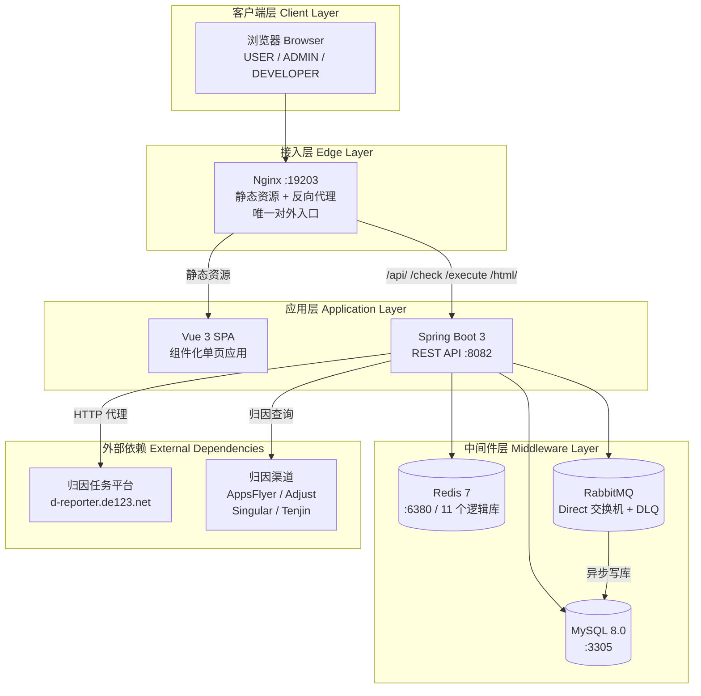
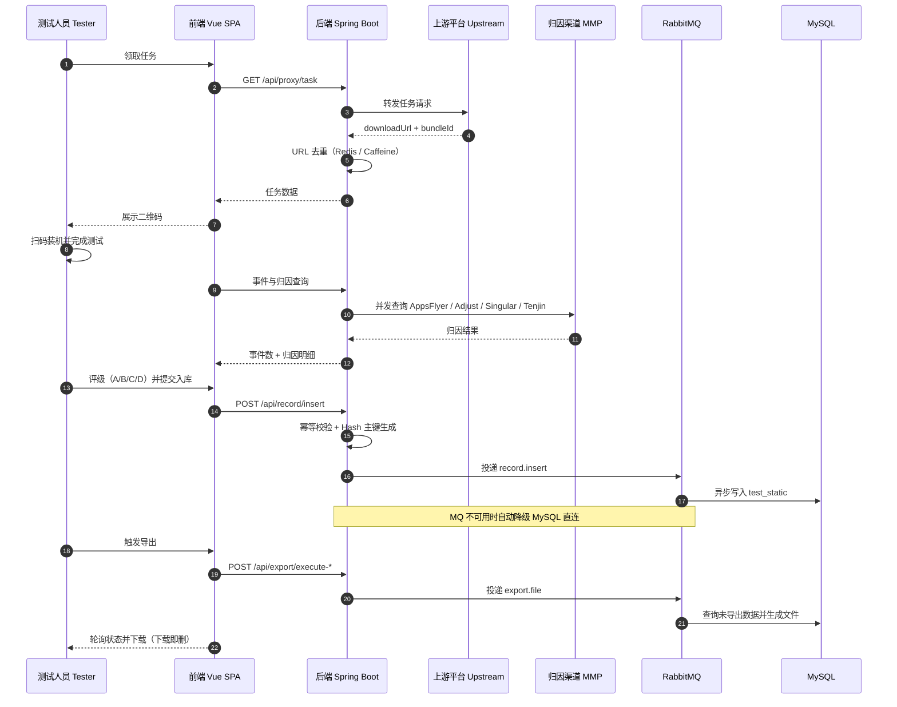
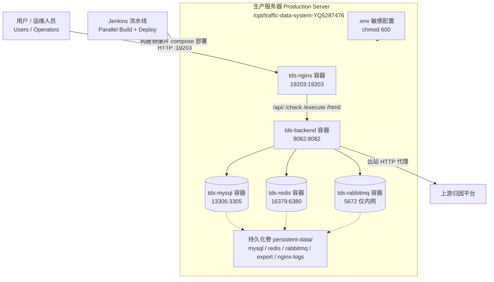
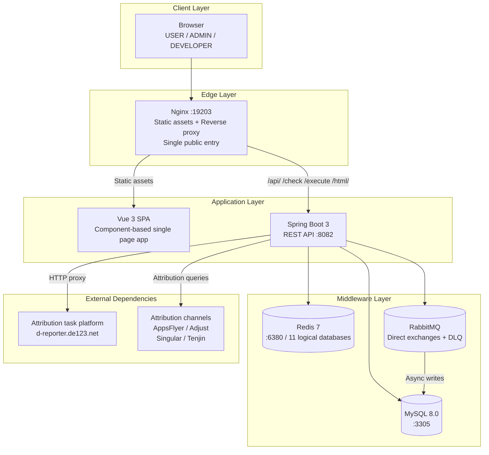
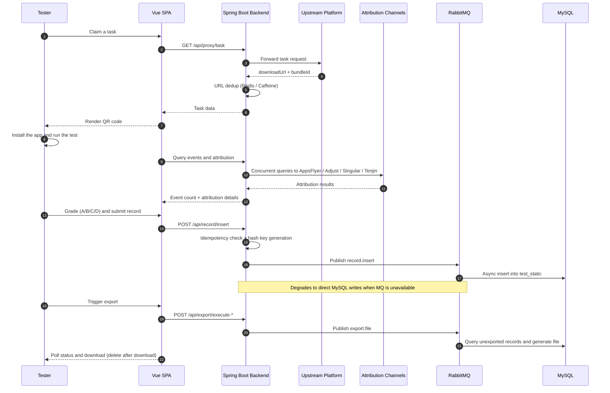
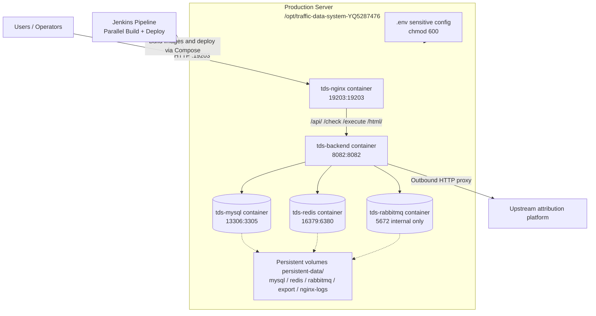

# data-traffic-system-YQ5287476

## 法律声明与许可条款

本仓库（包括但不限于源代码、架构设计、配置文件、文档、脚本及数据模型）为**深圳市慧动创想科技有限公司**的专有保密资产，受《中华人民共和国著作权法》《计算机软件保护条例》《反不正当竞争法》及相关国际知识产权条约的保护。

**使用限制：**

1. **仅限查阅**：本仓库仅向经深圳市慧动创想科技有限公司书面授权的人员开放查阅权限。未经公司书面许可，任何个人或组织不得以任何形式复制、转载、修改、分发、展示、传播、派生或商业利用本仓库的任何内容。
2. **禁止克隆与派生**：严禁对本仓库执行 `git clone`、`git fork`、镜像同步或任何形式的代码拉取操作，仅限于在线浏览查阅。
3. **保密义务**：访问本仓库即表示您同意对其中的全部信息承担保密义务。任何未经授权的泄露、使用或传播行为均可能构成对公司商业秘密的侵犯。
4. **违约责任**：违反本声明的任何行为，深圳市慧动创想科技有限公司保留依法追究其民事及刑事责任的全部权利，包括但不限于要求停止侵害、赔偿损失及承担相关法律费用。
5. **适用范围**：本声明适用于全球范围内的一切个人与组织，不因任何地域、时间或使用场景而失效。

**版权声明**：Copyright (c) 2024-2026 深圳市慧动创想科技有限公司。保留所有权利。

自动化测试数据管理系统（Automated Test Data Management System）

面向广告投放测试场景的一体化数据管理平台：覆盖任务领取、测试执行、事件与归因查询、数据入库、评级复测、异步导出与统计报表的完整业务闭环。本文档定位为开发与运维交接手册，同时可作为技术面试的架构展示材料。

版本信息：前端 auto-test-frontend v3.0.0 | 后端 Automatic_test_script 1.0-SNAPSHOT

## 目录

- [项目简介](#项目简介)
- [核心特性](#核心特性)
- [技术栈](#技术栈)
- [系统架构](#系统架构)
- [核心业务流程](#核心业务流程)
- [部署拓扑](#部署拓扑)
- [仓库结构](#仓库结构)
- [本地开发](#本地开发)
- [构建与部署](#构建与部署)
- [运维手册](#运维手册)
- [数据模型](#数据模型)
- [角色与权限](#角色与权限)
- [已知限制与改进路线](#已知限制与改进路线)
- [English Version](#english-version)

## 项目简介

系统面向广告投放测试团队：测试人员通过平台领取上游归因平台分发的测试任务，获得被测应用的下载链接与二维码，完成装机与测试后，平台一键查询事件数据与四家第三方归因渠道（AppsFlyer、Adjust、Singular、Tenjin）的归因结果，并将测试记录持久化入库；管理员在此基础上进行评级管理、复测调度、统计报表与数据导出，取代人工逐平台查询与手工整理数据的工作方式。

系统解决的核心问题：多归因渠道结果分散导致查询重复劳动；测试数据缺乏统一存储与管理；报表导出效率低；重复领取任务造成数据污染；多用户共用一套数据源的隔离问题。

## 核心特性

- 任务领取与 URL 去重：代理上游任务接口，基于 Redis 对已领取任务去重（TTL 1 天），Redis 不可用时自动降级 Caffeine 本地缓存，并通过多实例心跳会话支持去重状态的分布式一致性。
- 一键事件与归因查询：单次操作并发查询四家归因渠道结果，自动判定事件有无，优先取 AppsFlyer 最近上报时间。
- 版本一致性校验：检测被测应用版本漂移，不一致时自动停止二次下发，避免无效测试流量。
- 幂等入库与 Hash 主键：submissionId 幂等控制（Redis TTL 24 小时）+ SHA-256 Hash 主键（含碰撞检测与自愈重生成），重复提交零污染。
- 异步消息处理与双降级：入库/更新/删除经 RabbitMQ 异步化（手动 ACK、发布确认），MQ 不可用时自动降级 MySQL 直连并定时探测恢复；Redis 不可用时降级本地缓存。
- 死信治理：全量 DLQ（死信队列）体系，死信自动记录、告警通知，管理端支持死信查看、重发与清空。
- 评级与复测体系：A/B/C/D 四级评级并缓存加速查询，B 级以上近 3 天数据自动预热为复测候选池，支持随机抽取复测。
- 异步导出与下载即焚：导出任务异步执行，完成后流式下载并在服务端即时删除文件，夜间定时清理残留文件。
- 三级角色权限：USER / ADMIN / DEVELOPER 角色化界面与功能隔离。
- 多租户动态数据源：按用户动态创建独立 Hikari 连接池并路由请求，实现用户级数据隔离。
- 自研注解式横切框架：分布式锁、幂等、方法缓存、重试、超时、敏感日志脱敏、执行时长统计共 7 个注解，基于 AOP 统一实现。
- 可观测性：Actuator + Prometheus 指标暴露、MQ 死信监控面板、操作审计日志、实时日志查看与 Redis 状态监控。

## 技术栈

后端：

| 类别 | 技术 | 版本 |
|------|------|------|
| 运行时 | Java（容器运行时） | JDK 17 |
| 框架 | Spring Boot | 3.2.0 |
| 持久层 | MyBatis / MyBatis-Plus | 3.0.2 / 3.5.5 |
| 数据库 | MySQL | 8.0 |
| 缓存 | Redis | 7（Alpine） |
| 消息队列 | RabbitMQ（Spring AMQP） | 3-management |
| 连接池 | HikariCP | 5.0.1 |
| API 文档 | springdoc-openapi（Swagger UI） | 2.6.0 |
| 监控 | Actuator + Micrometer Prometheus + OSHI | - |
| 基础库 | Lombok / Guava / Caffeine / Bucket4j / httpclient5 | - |

前端：

| 类别 | 技术 | 版本 |
|------|------|------|
| 框架 | Vue 3（Composition API） | 3.4 |
| 构建工具 | Vite | 5.4 |
| 图表 | Chart.js | 4.5 |
| 二维码 | qrcode | 1.5 |

部署与基础设施：

| 类别 | 技术 |
|------|------|
| CI/CD | Jenkins（Declarative Pipeline） |
| 容器编排 | Docker Compose |
| 接入层 | Nginx（静态资源 + 反向代理） |

## 系统架构

系统采用经典的「接入层 - 应用层 - 中间件层」分层架构，后端作为业务中枢同时承担上游平台代理与归因查询职责。



架构设计要点：

- 双降级策略：RabbitMQ 不可用时入库链路自动降级为 MySQL 直连（原子开关 + 30 秒健康探测恢复）；Redis 不可用时去重与缓存降级为 Caffeine 本地缓存，保证核心链路可用性。
- 幂等与唯一性设计：入库幂等基于 submissionId + Redis（24 小时 TTL）；主键 Hash 基于 SHA-256 并通过 Redis 做全局碰撞检测。
- 多租户数据源：用户级动态数据源通过 ThreadLocal 上下文贯穿 HTTP 拦截器与 MQ 消费者，实现「每个用户一套 MySQL 连接池」。
- 注解式横切关注点：分布式锁、幂等、缓存、重试、超时、脱敏、耗时统计通过 7 个自定义注解 + AOP 实现，业务代码与横切逻辑解耦。
- Redis 逻辑分库：11 个逻辑库按业务域隔离（去重、会话、评级、幂等、Hash 唯一性、通知、数据源等），各自使用独立 RedisTemplate。

## 核心业务流程



流程说明：

- 任务领取：前端调用 `/api/proxy/task`，后端转发上游任务接口；去重命中时返回 duplicate 标识，前端自动重试（最多 5 次，间隔 1.5 秒）。
- 测试执行：二维码由前端 qrcode 库本地渲染，不产生图片文件；倒计时结束后自动触发事件查询。
- 版本校验：事件接口返回的 currentVersion 与 checkVersion 不一致时，前端展示提示并调用停止下发接口。
- 入库：无事件的任务支持冻结标记；有事件但无归因的任务追加备注；日期统一规范化存储。
- 导出：支持全量、按日期、按指定记录三种模式；前端轮询导出状态，下载完成后服务端即时删除文件。

## 部署拓扑

生产环境为单机 Docker Compose 编排，由 Jenkins 流水线完成构建与部署。



端口映射：

| 服务 | 容器名 | 宿主机端口 | 容器端口 | 对外暴露 |
|------|--------|-----------|----------|----------|
| nginx | tds-nginx | 19203 | 19203 | 是（唯一业务入口） |
| backend | tds-backend | 8082 | 8082 | 是（建议收紧） |
| mysql | tds-mysql | 13306 | 3305 | 否（维护通道） |
| redis | tds-redis | 16379 | 6380 | 否（维护通道） |
| rabbitmq | tds-rabbitmq | 未映射 | 5672 / 15672 | 否（仅内网） |

网络与容器说明：

- 所有容器接入自定义桥接网络 traffic-data-system-dev-net，服务间通过容器名互访（如 backend 访问 mysql:3305、redis:6380）。
- 后端启动依赖三个中间件健康检查通过（depends_on + healthcheck），保证启动顺序正确。
- nginx 镜像在部署现场构建（frontend 上下文 + deploy/Dockerfile），静态资源随镜像发布。
- 后端容器挂载 persistent-data/export 用于导出文件；其余数据全部落盘于 persistent-data 下对应子目录。
- .env 由 Jenkins 凭证注入生成，权限 600，不进入仓库与镜像。

## 仓库结构

```text
data-traffic-system-YQ5287476/
├── Jenkinsfile                    # CI/CD 流水线定义（并行构建 + 部署 + 镜像治理）
├── docker-compose.cicd.yml        # 生产编排（mysql / redis / rabbitmq / backend / nginx）
├── backend/                       # Spring Boot 后端
│   ├── Dockerfile                 # eclipse-temurin:17-jdk-alpine
│   ├── pom.xml
│   └── src/main/
│       ├── java/org/example/
│       │   ├── annotation/        # 7 个自定义注解（锁/幂等/缓存/重试/超时/脱敏/耗时）
│       │   ├── aop/               # 注解对应切面实现
│       │   ├── common/            # 统一返回、异常处理、用户上下文
│       │   ├── config/            # 中间件、多租户数据源、拦截器配置
│       │   ├── controller/        # 19 个 REST 控制器
│       │   ├── entity/            # MyBatis-Plus 实体（8 张表）
│       │   ├── mapper/            # Mapper 接口（注解 SQL）
│       │   ├── mq/                # RabbitMQ 生产者 / 消费者 / 死信处理
│       │   ├── service/           # 业务服务层
│       │   └── util/              # 通用工具（远程请求、日志脱敏等）
│       └── resources/application.yml
└── frontend/                      # Vue 3 前端
    ├── deploy/
    │   ├── Dockerfile             # nginx:1.21-alpine 镜像构建
    │   └── conf.d/nginx.conf      # 站点、安全加固与反向代理配置
    ├── package.json
    ├── vite.config.js
    └── src/
        ├── App.vue                # 根组件（登录 + 布局 + 角色化模块装配）
        ├── api/index.js           # 接口封装（90+ 函数，fetch + 超时控制）
        ├── components/            # 17 个业务组件
        └── utils/                 # 工具与 composable
```

## 本地开发

前置要求：JDK 17+（构建版本需与 pom.xml 编译目标一致，见「已知限制与改进路线」）、Maven 3.8+、Node.js 18+；本地需准备 MySQL、Redis、RabbitMQ 实例或可访问的开发环境中间件。

后端启动：

```bash
cd backend
mvn clean package -DskipTests
java -jar target/Automatic_test_script-1.0-SNAPSHOT.jar
```

说明：application.yml 中数据库地址为 mysql:3305、Redis 为 redis:6380（容器内服务名与端口），本地运行时需按实际中间件地址调整连接配置。

前端启动：

```bash
cd frontend
npm install
npm run dev
```

说明：vite.config.js 未配置 /api 开发代理，前端所有请求为同源相对路径；本地联调时需自行添加 dev proxy 或与后端同源部署。

## 构建与部署

发布流程由 Jenkins 流水线（仓库根 Jenkinsfile）驱动，全流程为：

1. 拉取代码：git reset + clean 保证工作区干净，记录本次部署的 Commit SHA。
2. 并行构建：后端 Maven 打包（依赖缓存 /opt/jenkins-cache/.m2）并构建镜像（标签为 Commit SHA 与 latest）；前端 npm install（缓存 /opt/jenkins-cache/node_modules）后 vite build。
3. 部署：准备部署目录与持久化目录，通过 Jenkins 凭证生成 .env（数据库与 RabbitMQ 凭据，权限 600），按 DEPLOY_SCOPE 参数执行 docker compose down + up。
4. 资源治理：保留最新 3 个后端镜像，清理 24 小时以上的构建缓存、停止容器与悬空镜像。

构建参数：

| 参数 | 取值 | 说明 |
|------|------|------|
| DEPLOY_SCOPE | all / backend / frontend | 部署范围（当前仅 all 与 frontend 生效） |

部署目录与制品：

| 项 | 位置 / 值 |
|------|-----------|
| 部署目录 | /opt/traffic-data-system-YQ5287476 |
| 后端镜像 | myapp-backend:\<commit-sha\>（另打 latest 标签） |
| 前端镜像 | tds-nginx:latest（部署现场构建） |
| 敏感配置 | 部署目录 .env（Jenkins 凭证注入） |
| 数据目录 | persistent-data/{mysql,redis,rabbitmq,export,nginx-logs} |

回滚方式：以目标历史提交重新触发流水线即可，镜像按 Commit SHA 标签隔离，无需额外回滚脚本。

首次部署前置条件：部署服务器需预先创建 /opt/jenkins-cache 缓存目录；需在部署目录手工维护 mysql/conf/my.cnf 与 mysql/initsql 初始化脚本（未随仓库提交，详见「已知限制与改进路线」）。

## 运维手册

健康检查：

| 检查项 | 方式 |
|--------|------|
| 容器状态 | docker compose ps（compose 已为 mysql/redis/rabbitmq 配置 healthcheck） |
| 入口探测 | GET /check（nginx 已配置代理路由并关闭访问日志；后端对应端点待补充） |
| 后端健康 | GET /actuator/health（含 db/redis/rabbit 检查项） |
| 指标监控 | GET /actuator/prometheus |
| 前端版本 | 响应头 X-Deploy-Id 与浏览器本地标识比对，版本漂移自动强制下线 |

说明：nginx 配置中的 /check 与 /execute 为历史路由，后端当前未实现对应根路径端点（/execute 的前端调用已移除），探活请优先使用 /actuator/health。

日志：

- 后端：容器内 /data/logs/app.log（100MB 滚动、保留 30 天、MDC 注入用户名），可通过 docker logs -f tds-backend 或系统内「监控面板」实时查看。
- 接入层：persistent-data/nginx-logs（每次部署时自动清空）。
- 操作审计：系统内「审计日志」模块，支持检索与定时清理。

数据与备份：

- 全部业务数据落盘于 persistent-data 目录（MySQL、Redis AOF、RabbitMQ、导出文件）。
- 备份策略：优先 mysqldump 逻辑备份 test_data 库；整机备份可直接复制 persistent-data 目录（需先停止容器保证一致性）。

MQ 死信处理：

- 死信自动入 Redis 记录并触发 MQ_ALERT 告警通知。
- 管理端「MQ 监控」面板支持三类死信（insert/update/delete）的查看、重发与清空。

定时任务：

| 任务 | 频率 | 说明 |
|------|------|------|
| 导出文件清理 | 每日 03:00 | 清理超过 24 小时的导出文件 |
| 评级缓存刷新 | 每 120 秒 | 评级数据全量刷新至 Redis |
| appId 映射刷新 | 每 120 秒 | appId 缓存同步 |
| 复测缓存预热 | 每 600 秒 | 复测候选池键过期检查与重预热 |
| MQ 连接探测 | 每 30 秒 | 不可用时切换 MySQL 直连 |
| 去重会话心跳 | 每 10 秒 | 多实例去重会话存活检测 |
| 动态调度 | scheduled_task 表驱动 | 审计日志清理等任务可在线启停 |

安全基线：

- nginx：server_tokens off、HTTP 方法白名单、X-Frame-Options / nosniff / X-XSS-Protection 响应头、隐藏文件拒绝访问。
- 应用：BCrypt 密码散列、HttpOnly Cookie 会话（单用户最多 5 会话）、支持踢下线与封禁、IP 限流（200 次/分钟，超限封禁 2 分钟）、敏感字段日志脱敏。
- 运维：敏感凭据全部走 Jenkins 凭证管理，.env 权限 600，禁止进入版本库与镜像。

常见运维操作：

```bash
# 查看服务状态
docker compose -f /opt/traffic-data-system-YQ5287476/docker-compose.cicd.yml ps

# 查看后端日志
docker logs -f tds-backend

# 进入 MySQL 容器（宿主机维护通道 13306）
mysql -h 127.0.0.1 -P 13306 -u remote_user -p

# Redis 维护通道（容器端口 6380）
redis-cli -h 127.0.0.1 -p 16379

# RabbitMQ 管理控制台：编排文件默认未映射 15672 端口
# 如需访问，为 tds-rabbitmq 服务临时增加 ports: "15672:15672" 后执行：
docker compose -f docker-compose.cicd.yml up -d rabbitmq
```

## 数据模型

MySQL 数据库名：test_data（由 Compose 初始化创建）。表清单：

| 表 | 说明 |
|------|------|
| test_static | 主业务表：测试记录（Hash 主键、事件数、归因平台、日期、记录人等） |
| appid | 应用 ID 与 bundleId 映射表 |
| grade_bundle | 评级表（bundleId 到 A/B/C/D 评级） |
| user | 用户与角色表 |
| notification | 站内通知（MySQL 存储） |
| alert_notification | 告警通知 |
| audit_log | 操作审计日志 |
| scheduled_task | 动态定时任务定义表 |

说明：表结构由部署服务器的 mysql/initsql 初始化脚本创建；全量通知另有基于 Redis 的全局通知实现。

## 角色与权限

| 角色 | 定位 | 可用模块 |
|------|------|----------|
| USER | 一线测试人员 | 自动模式、手动模式、二维码生成、数据看板与导出、评级管理、通知中心、数据源切换 |
| ADMIN | 管理员 | USER 全部 + 管理员看板（报表/管理/App 信息/复测缓存/用户管理）、审计日志、定时任务、通知管理 |
| DEVELOPER | 开发者 / 运维 | ADMIN 全部 + 开发者模式、监控面板（日志/Redis/终端）、MQ 监控、建表工具 |

## 已知限制与改进路线

| 类别 | 现状 | 改进方向 |
|------|------|----------|
| 工具链一致性 | pom.xml 编译目标为 Java 26，容器运行时为 JDK 17，版本不一致时构建产物无法在容器运行 | 统一编译与运行时 JDK 版本（建议对齐 17） |
| 高可用 | 限流与部分缓存为单机实现（拦截器 + 本地缓存），多实例扩展时语义受限 | 引入分布式限流与集群化缓存方案 |
| 消息可靠性 | update/delete 队列的消费者同时监听自身 DLQ，与统一死信消费者职责重叠 | 收敛为单一死信处理链路，明确重发语义 |
| 安全加固 | 高危运维操作（远程终端、SQL 执行）当前依赖前端角色隔离 | 补充服务端权限校验与全量操作审计闭环 |
| 外部依赖 | 上游归因平台为直连 HTTP 代理，无鉴权机制 | 与上游约定接入鉴权或请求签名 |
| 网络暴露 | 后端 8082 直连宿主机，MySQL/Redis 使用非常规端口 | 收紧暴露面，仅保留 19203 对外，非常规端口改为内网约定 |
| 配置管理 | mysql/conf/my.cnf 与 mysql/initsql 未随仓库版本化；application.yml 无多环境拆分 | 初始化脚本纳入版本管理，配置按环境拆分 |
| 前端工程 | 无路由与状态管理（组件切换模式），存在少量未引用工具模块；静态资源依赖 Google Fonts CDN | 按需引入 Vue Router / Pinia，字体资源本地化，清理死代码 |
| 构建脚本 | Jenkinsfile 前端阶段仍将 dist 复制至 ../nginx/html/dist（历史路径，当前 Compose 已改用 frontend 上下文构建） | 清理历史路径，保持流水线与编排配置一致 |

---

## English Version

## Legal Notice and License Terms

This repository — including but not limited to its source code, architecture designs, configuration files, documentation, scripts, and data models — is the exclusive proprietary and confidential asset of **Shenzhen Huidong Chuangxiang Technology Co., Ltd.** (深圳市慧动创想科技有限公司), protected by the Copyright Law of the People's Republic of China, the Regulations on Computer Software Protection, the Anti-Unfair Competition Law, and applicable international intellectual property treaties.

**Restrictions:**

1. **View-only access**: This repository is open for review exclusively to personnel who have received written authorization from Shenzhen Huidong Chuangxiang Technology Co., Ltd. Without prior written consent, no individual or organization may copy, reproduce, modify, distribute, display, transmit, create derivative works from, or commercially exploit any content of this repository in any form or by any means.
2. **No cloning or forking**: Performing `git clone`, `git fork`, mirror synchronization, or any form of code replication from this repository is strictly prohibited. Online browsing for review purposes only.
3. **Confidentiality obligation**: By accessing this repository, you agree to maintain the confidentiality of all information contained herein. Any unauthorized disclosure, use, or dissemination may constitute an infringement of the company's trade secrets.
4. **Liability for breach**: Shenzhen Huidong Chuangxiang Technology Co., Ltd. reserves the right to pursue all available civil and/or criminal remedies against any party that violates this notice, including but not limited to seeking injunctive relief, damages, and recovery of legal costs.
5. **Scope**: This notice applies to all individuals and organizations worldwide and shall not be rendered invalid by any geographic, temporal, or situational context.

**Copyright Notice**: Copyright (c) 2024-2026 Shenzhen Huidong Chuangxiang Technology Co., Ltd. All rights reserved.

### Table of Contents

- [Project Overview](#project-overview)
- [Key Features](#key-features)
- [Technology Stack](#technology-stack)
- [System Architecture](#system-architecture)
- [Core Business Flow](#core-business-flow)
- [Deployment Topology](#deployment-topology)
- [Repository Structure](#repository-structure)
- [Local Development](#local-development)
- [Build and Deployment](#build-and-deployment)
- [Operations Manual](#operations-manual)
- [Data Model](#data-model)
- [Roles and Permissions](#roles-and-permissions)
- [Known Limitations and Roadmap](#known-limitations-and-roadmap)

### Project Overview

An integrated data management platform for ad-campaign testing scenarios. Testers claim tasks distributed by the upstream attribution platform, receive the download link and QR code of the application under test, and after installation and testing, the platform queries event data and attribution results from four MMP channels (AppsFlyer, Adjust, Singular, Tenjin) in one step, then persists the test records. Administrators further perform grade management, retest scheduling, statistics, and data export on top of it, replacing manual per-platform querying and spreadsheet-based data handling.

Core problems addressed: scattered attribution results across channels causing repetitive manual queries; lack of unified storage and management of test data; low efficiency of report export; data pollution from duplicate task claiming; and missing isolation when multiple users share a single data source.

### Key Features

- Task claiming with URL deduplication: proxies the upstream task API, deduplicates claimed tasks via Redis (1-day TTL), falls back to Caffeine local cache when Redis is unavailable, and maintains dedup consistency across instances through pod heartbeat sessions.
- One-click event and attribution query: queries all four attribution channels concurrently, determines event presence automatically, and prefers the latest AppsFlyer report time.
- Version consistency check: detects version drift of the app under test and stops secondary delivery automatically to avoid invalid test traffic.
- Idempotent insert with hash primary key: submissionId idempotency (24-hour TTL) plus SHA-256 hash primary key with collision detection and self-healing regeneration; duplicate submissions cause zero data pollution.
- Async messaging with dual degradation: insert/update/delete go through RabbitMQ asynchronously (manual ACK, publisher confirms); when MQ is unavailable the system degrades to direct MySQL writes and probes for recovery; when Redis is unavailable it degrades to local caching.
- Dead letter governance: a full DLQ system with automatic dead letter recording and alerting; the admin console supports viewing, republishing, and clearing dead letters.
- Grade and retest system: four-level grading (A/B/C/D) with cache acceleration; data graded B or above within the last 3 days is pre-warmed into a retest candidate pool with random selection.
- Async export with download-and-delete: export tasks run asynchronously; files are streamed for download and deleted on the server immediately, with nightly cleanup of leftovers.
- Three-tier role model: USER / ADMIN / DEVELOPER role-based UI and capability isolation.
- Multi-tenant dynamic data sources: per-user Hikari connection pools created dynamically with request routing for user-level data isolation.
- Annotation-based cross-cutting framework: seven custom annotations (distributed lock, idempotency, method cache, retry, timeout, sensitive log masking, execution time) implemented uniformly via AOP.
- Observability: Actuator + Prometheus metrics, MQ dead letter monitoring panel, operation audit logs, live log tailing, and Redis status monitoring.

### Technology Stack

Backend:

| Category | Technology | Version |
|----------|------------|---------|
| Runtime | Java (container runtime) | JDK 17 |
| Framework | Spring Boot | 3.2.0 |
| Persistence | MyBatis / MyBatis-Plus | 3.0.2 / 3.5.5 |
| Database | MySQL | 8.0 |
| Cache | Redis | 7 (Alpine) |
| Message Queue | RabbitMQ (Spring AMQP) | 3-management |
| Connection Pool | HikariCP | 5.0.1 |
| API Docs | springdoc-openapi (Swagger UI) | 2.6.0 |
| Monitoring | Actuator + Micrometer Prometheus + OSHI | - |
| Libraries | Lombok / Guava / Caffeine / Bucket4j / httpclient5 | - |

Frontend:

| Category | Technology | Version |
|----------|------------|---------|
| Framework | Vue 3 (Composition API) | 3.4 |
| Build Tool | Vite | 5.4 |
| Charts | Chart.js | 4.5 |
| QR Code | qrcode | 1.5 |

Deployment and Infrastructure:

| Category | Technology |
|----------|------------|
| CI/CD | Jenkins (Declarative Pipeline) |
| Container Orchestration | Docker Compose |
| Edge Layer | Nginx (static assets + reverse proxy) |

### System Architecture

The system follows a classic edge-application-middleware layered architecture. The backend serves as the business hub and also proxies the upstream platform and queries attribution channels.



Architecture highlights:

- Dual degradation: when RabbitMQ is unavailable, the insert path degrades to direct MySQL writes (atomic switch plus 30-second health probing); when Redis is unavailable, dedup and caches degrade to Caffeine local cache, keeping the core path available.
- Idempotency and uniqueness: insert idempotency based on submissionId plus Redis (24-hour TTL); hash primary keys derived from SHA-256 with global collision detection via Redis.
- Multi-tenant data sources: per-user dynamic data sources carried through a ThreadLocal context across both HTTP interceptors and MQ consumers, achieving one connection pool per user.
- Annotation-based cross-cutting concerns: distributed lock, idempotency, cache, retry, timeout, masking, and timing are implemented through seven custom annotations with AOP, decoupling business code from infrastructure logic.
- Redis logical sharding: 11 logical databases isolated by business domain (dedup, sessions, grades, idempotency, hash uniqueness, notifications, data sources, etc.), each with a dedicated RedisTemplate.

### Core Business Flow



Flow notes:

- Task claiming: the frontend calls /api/proxy/task and the backend forwards to the upstream task API; when dedup hits, a duplicate flag is returned and the frontend retries automatically (up to 5 attempts, 1.5-second interval).
- Test execution: the QR code is rendered locally by the qrcode library without image files; a countdown automatically triggers the event query.
- Version check: when currentVersion from the event API differs from checkVersion, the frontend shows a warning and calls the stop-delivery endpoint.
- Insert: tasks without events support a frozen flag; tasks with events but no attribution get an appended remark; dates are normalized before storage.
- Export: supports full export, export by date, and export by selected records; the frontend polls export status, and the server deletes the file immediately after download.

### Deployment Topology

Production is a single-host Docker Compose deployment driven by a Jenkins pipeline.



Port mapping:

| Service | Container | Host Port | Container Port | Public Exposure |
|---------|-----------|-----------|----------------|-----------------|
| nginx | tds-nginx | 19203 | 19203 | Yes (the only business entry) |
| backend | tds-backend | 8082 | 8082 | Yes (tightening recommended) |
| mysql | tds-mysql | 13306 | 3305 | No (maintenance only) |
| redis | tds-redis | 16379 | 6380 | No (maintenance only) |
| rabbitmq | tds-rabbitmq | Not mapped | 5672 / 15672 | No (internal only) |

Network and container notes:

- All containers join the custom bridge network traffic-data-system-dev-net and reach each other by container name (e.g., backend connects to mysql:3305 and redis:6380).
- The backend waits for all three middleware health checks to pass (depends_on + healthcheck), guaranteeing startup order.
- The nginx image is built on site (frontend context + deploy/Dockerfile); static assets ship with the image.
- The backend container mounts persistent-data/export for export files; all other data persists under the corresponding subdirectories of persistent-data.
- .env is generated from Jenkins credentials with 600 permissions and never enters the repository or images.

### Repository Structure

```text
data-traffic-system-YQ5287476/
├── Jenkinsfile                    # CI/CD pipeline (parallel build + deploy + image governance)
├── docker-compose.cicd.yml        # Production compose (mysql / redis / rabbitmq / backend / nginx)
├── backend/                       # Spring Boot backend
│   ├── Dockerfile                 # eclipse-temurin:17-jdk-alpine
│   ├── pom.xml
│   └── src/main/
│       ├── java/org/example/
│       │   ├── annotation/        # 7 custom annotations (lock/idempotent/cache/retry/timeout/mask/timing)
│       │   ├── aop/               # Aspect implementations
│       │   ├── common/            # Unified response, exceptions, user context
│       │   ├── config/            # Middleware, multi-tenant datasource, interceptor configs
│       │   ├── controller/        # 19 REST controllers
│       │   ├── entity/            # MyBatis-Plus entities (8 tables)
│       │   ├── mapper/            # Mapper interfaces (annotation SQL)
│       │   ├── mq/                # RabbitMQ producers / consumers / DLQ handling
│       │   ├── service/           # Business service layer
│       │   └── util/              # Utilities (remote requests, log masking, etc.)
│       └── resources/application.yml
└── frontend/                      # Vue 3 frontend
    ├── deploy/
    │   ├── Dockerfile             # nginx:1.21-alpine image build
    │   └── conf.d/nginx.conf      # Site, hardening, and reverse proxy config
    ├── package.json
    ├── vite.config.js
    └── src/
        ├── App.vue                # Root component (login + layout + role-based module assembly)
        ├── api/index.js           # API wrapper (90+ functions, fetch + timeout control)
        ├── components/            # 17 business components
        └── utils/                 # Utilities and composables
```

### Local Development

Prerequisites: JDK 17+ (the build version must match the compiler target in pom.xml, see Known Limitations and Roadmap), Maven 3.8+, Node.js 18+, and access to MySQL, Redis, and RabbitMQ instances.

Backend:

```bash
cd backend
mvn clean package -DskipTests
java -jar target/Automatic_test_script-1.0-SNAPSHOT.jar
```

Note: application.yml points to mysql:3305 and redis:6380 (in-container service names and ports); adjust the connection settings to your local middleware when running outside containers.

Frontend:

```bash
cd frontend
npm install
npm run dev
```

Note: vite.config.js does not configure a /api dev proxy; all requests are same-origin relative paths. Add a dev proxy or deploy the frontend behind the same origin as the backend for local integration.

### Build and Deployment

The release process is driven by the Jenkins pipeline (Jenkinsfile at the repository root):

1. Checkout: git reset + clean to guarantee a clean workspace; records the Commit SHA of this deployment.
2. Parallel build: Maven package for the backend (dependency cache at /opt/jenkins-cache/.m2) followed by image build (tagged with the Commit SHA plus latest); npm install for the frontend (cache at /opt/jenkins-cache/node_modules) followed by vite build.
3. Deploy: prepare the deploy directory and persistent directories, generate .env from Jenkins credentials (database and RabbitMQ credentials, 600 permissions), then run docker compose down + up according to the DEPLOY_SCOPE parameter.
4. Resource governance: keep the latest 3 backend images, clean build caches older than 24 hours, stopped containers, and dangling images.

Build parameter:

| Parameter | Values | Description |
|-----------|--------|-------------|
| DEPLOY_SCOPE | all / backend / frontend | Deployment scope (currently only all and frontend take effect) |

Deploy artifacts:

| Item | Location / Value |
|------|------------------|
| Deploy directory | /opt/traffic-data-system-YQ5287476 |
| Backend image | myapp-backend:\<commit-sha\> (plus latest tag) |
| Frontend image | tds-nginx:latest (built on site) |
| Sensitive config | .env in the deploy directory (injected from Jenkins credentials) |
| Data directories | persistent-data/{mysql,redis,rabbitmq,export,nginx-logs} |

Rollback: re-trigger the pipeline with the target historical commit; images are isolated by Commit SHA tags, so no additional rollback scripts are required.

First-deploy prerequisites: create /opt/jenkins-cache on the server beforehand; manually maintain mysql/conf/my.cnf and the mysql/initsql initialization scripts in the deploy directory (not committed to the repository; see Known Limitations and Roadmap).

### Operations Manual

Health checks:

| Check | Method |
|-------|--------|
| Container status | docker compose ps (healthchecks configured for mysql/redis/rabbitmq) |
| Entry probe | GET /check (proxied by nginx with access log disabled; the backend endpoint is not yet implemented) |
| Backend health | GET /actuator/health (includes db/redis/rabbit indicators) |
| Metrics | GET /actuator/prometheus |
| Frontend version | X-Deploy-Id response header compared with the browser-side identifier; version drift forces logout |

Note: /check and /execute in the nginx config are legacy routes without corresponding backend root endpoints (the frontend no longer calls /execute); prefer /actuator/health for liveness checks.

Logs:

- Backend: /data/logs/app.log inside the container (100MB rolling, 30-day retention, username injected into MDC); view via docker logs -f tds-backend or the in-app Monitoring panel.
- Edge: persistent-data/nginx-logs (cleared on each deployment).
- Audit: the in-app Audit Log module with search and scheduled cleanup.

Data and backup:

- All business data persists under persistent-data (MySQL, Redis AOF, RabbitMQ, export files).
- Backup strategy: prefer mysqldump logical backups of the test_data database; full-host backup can copy persistent-data (stop containers first for consistency).

MQ dead letters:

- Dead letters are recorded in Redis automatically and trigger MQ_ALERT notifications.
- The in-app MQ Monitor panel supports viewing, republishing, and clearing dead letters for all three queues (insert/update/delete).

Scheduled tasks:

| Task | Frequency | Description |
|------|-----------|-------------|
| Export file cleanup | Daily 03:00 | Remove export files older than 24 hours |
| Grade cache refresh | Every 120s | Full refresh of grade data into Redis |
| appId mapping refresh | Every 120s | appId cache synchronization |
| Retest cache warmup | Every 600s | Key expiry check and re-warmup of the retest pool |
| MQ connection probe | Every 30s | Switch to direct MySQL writes when unavailable |
| Dedup session heartbeat | Every 10s | Multi-instance dedup session liveness |
| Dynamic scheduling | Driven by scheduled_task table | Audit log cleanup and other tasks can be toggled online |

Security baseline:

- nginx: server_tokens off, HTTP method whitelist, X-Frame-Options / nosniff / X-XSS-Protection headers, deny access to hidden files.
- Application: BCrypt password hashing, HttpOnly cookie sessions (max 5 sessions per user), kick and ban support, IP rate limiting (200 requests per minute, 2-minute ban on overflow), sensitive field log masking.
- Operations: all sensitive credentials managed via Jenkins credentials, .env with 600 permissions, never committed or baked into images.

Common operations:

```bash
# Service status
docker compose -f /opt/traffic-data-system-YQ5287476/docker-compose.cicd.yml ps

# Backend logs
docker logs -f tds-backend

# MySQL via the host maintenance port 13306
mysql -h 127.0.0.1 -P 13306 -u remote_user -p

# Redis via the host maintenance port 16379
redis-cli -h 127.0.0.1 -p 16379

# RabbitMQ management console: port 15672 is not mapped by the Compose file
# To enable it, add ports: "15672:15672" to the tds-rabbitmq service, then run:
docker compose -f docker-compose.cicd.yml up -d rabbitmq
```

### Data Model

MySQL database name: test_data (created during Compose initialization). Tables:

| Table | Description |
|-------|-------------|
| test_static | Primary business table: test records (hash primary key, event counts, attribution channels, dates, recorders, etc.) |
| appid | App ID to bundleId mapping |
| grade_bundle | Grades (bundleId to A/B/C/D) |
| user | Users and roles |
| notification | In-app notifications (MySQL storage) |
| alert_notification | Alert notifications |
| audit_log | Operation audit logs |
| scheduled_task | Dynamic scheduled task definitions |

Note: table schemas are created by the init scripts under mysql/initsql on the deploy server; there is also a Redis-based global notification implementation.

### Roles and Permissions

| Role | Target | Available Modules |
|------|--------|-------------------|
| USER | Testers | Auto mode, Manual mode, QR code generator, Data board and export, Grade management, Notification center, Data source switching |
| ADMIN | Administrators | All USER modules + Admin board (reports / management / app info / retest cache / user management), Audit logs, Scheduled tasks, Notification management |
| DEVELOPER | Developers / Operators | All ADMIN modules + Developer mode, Monitoring panel (logs / Redis / terminal), MQ monitor, Table management tools |

### Known Limitations and Roadmap

| Category | Current State | Improvement Direction |
|----------|---------------|-----------------------|
| Toolchain consistency | pom.xml targets Java 26 while the container runtime is JDK 17; artifacts built under a mismatched toolchain fail to run in the container | Align the build and runtime JDK versions (recommend 17) |
| High availability | Rate limiting and parts of the cache are single-node implementations (interceptor + local cache), with limited semantics under multi-instance scaling | Introduce distributed rate limiting and cluster-aware caching |
| Message reliability | Consumers of the update/delete queues also listen to their own DLQs, overlapping with the unified dead letter consumer | Converge into a single DLQ handling chain with explicit republish semantics |
| Security hardening | High-risk operations (remote terminal, SQL execution) currently rely on frontend role isolation | Add server-side authorization and a full operation audit loop |
| External dependencies | The upstream attribution platform is accessed via a direct HTTP proxy without authentication | Agree with the upstream on authentication or request signing |
| Network exposure | Backend port 8082 is directly exposed on the host; MySQL/Redis use non-standard ports | Minimize exposure to 19203 only; convert non-standard ports to internal conventions |
| Configuration management | mysql/conf/my.cnf and mysql/initsql are not versioned in the repository; application.yml has no per-environment profiles | Version the init scripts; split configuration by environment |
| Frontend engineering | No router or state management (component-switching model); a few unused utility modules; static assets depend on the Google Fonts CDN | Introduce Vue Router / Pinia as needed, localize fonts, remove dead code |
| Build scripts | The Jenkinsfile frontend stage still copies dist to ../nginx/html/dist (legacy path; Compose now builds from the frontend context) | Remove the legacy path and keep the pipeline consistent with Compose |


> **CONFIDENTIAL & PROPRIETARY**
>
> Copyright (c) 2024-2026 深圳市慧动创想科技有限公司 (Shenzhen Huidong Chuangxiang Technology Co., Ltd.). All rights reserved.
>
> This repository is the exclusive proprietary and confidential software of 深圳市慧动创想科技有限公司. It is provided solely for authorized internal review purposes. **No part of this repository may be copied, reproduced, distributed, republished, downloaded, displayed, posted, transmitted, forked, cloned, or used in any form or by any means — electronic, mechanical, photocopying, recording, or otherwise — without the prior written consent of 深圳市慧动创想科技有限公司.**
>
> Unauthorized access, use, duplication, or distribution of this repository or any of its contents is strictly prohibited and may result in civil and/or criminal liability. This repository and all of its contents — including but not limited to source code, architecture designs, configuration files, documentation, scripts, and data models — constitute trade secrets and confidential information of 深圳市慧动创想科技有限公司.
>
> By accessing this repository, you acknowledge that you have read, understood, and agreed to be bound by these terms. If you are not an authorized employee, contractor, or agent of 深圳市慧动创想科技有限公司, you must immediately cease all access to this repository.
>
> **View-only access is permitted. Cloning, forking, mirroring, or any form of replication for external use is expressly forbidden.**